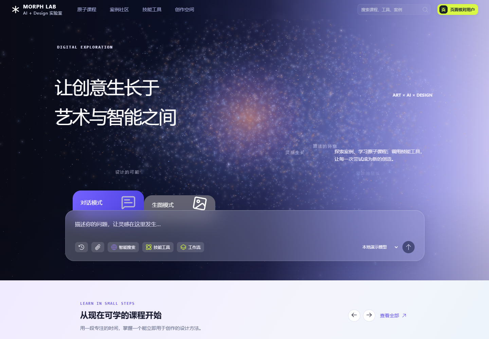
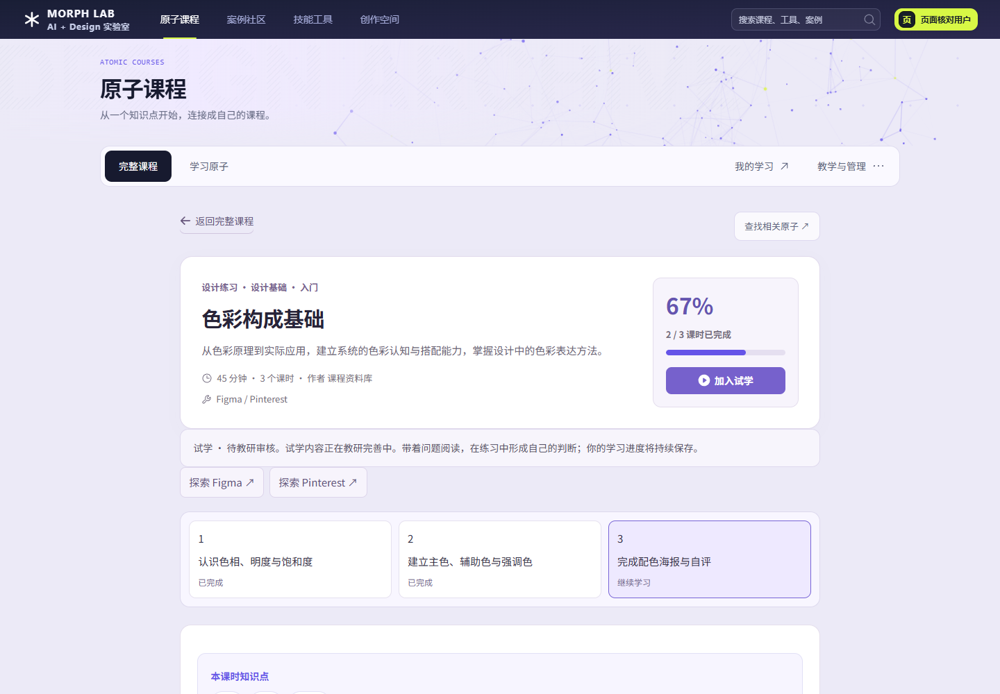
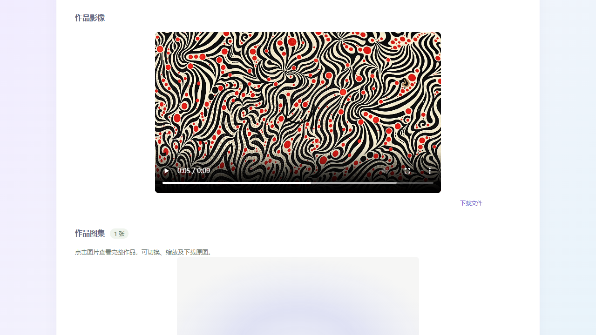
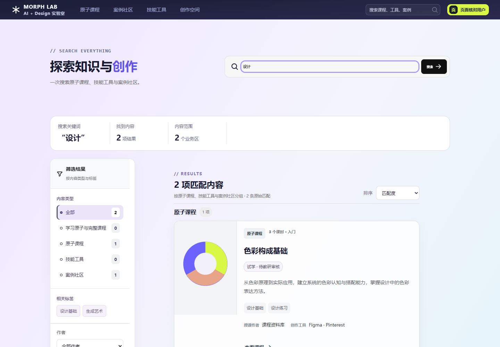
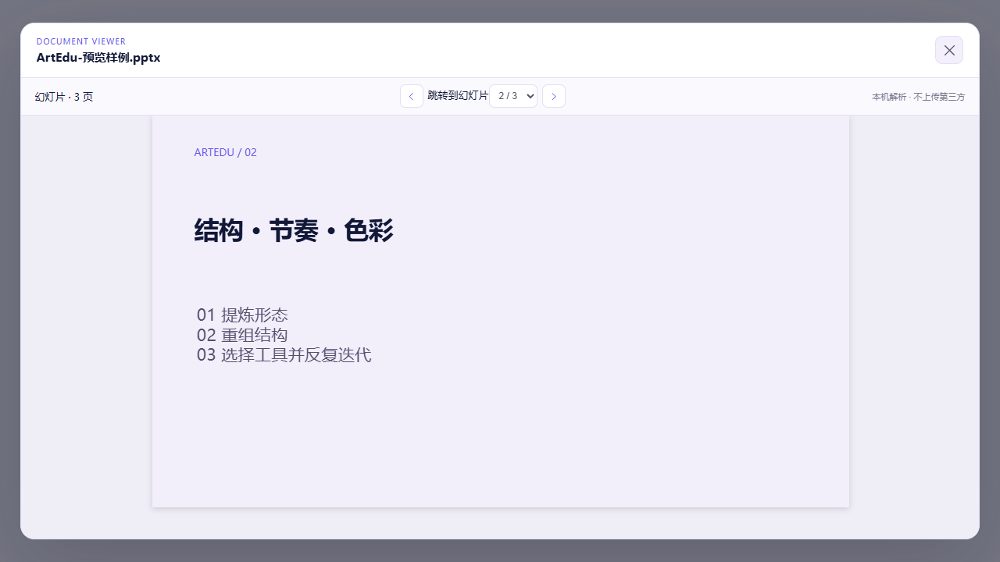
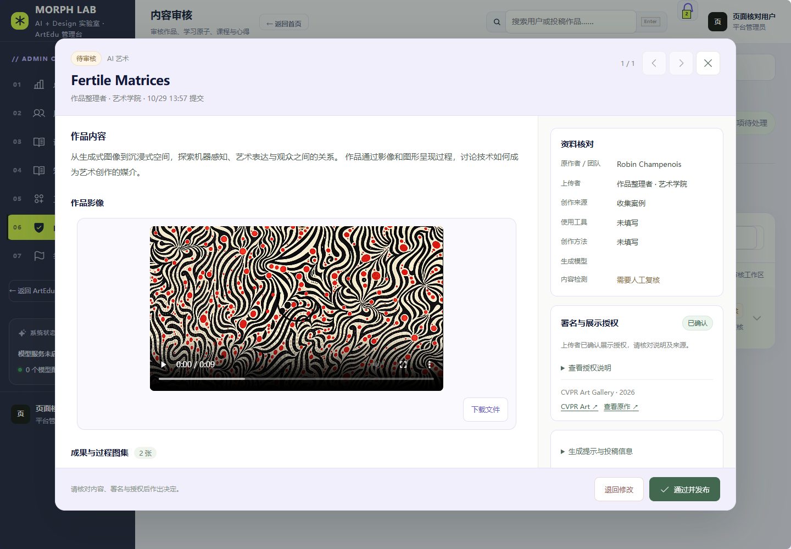

# 平台桌面页面与交互复核 · 2026-10-29

本轮从用户截图中的“案例目录遮挡视频”开始，检查24个页面入口，并补充短屏、长反馈、媒体、附件、弹窗和学生入口的专项操作。确认的10类问题已逐项修复。

检查方式：内置浏览器连接超时后，沿用此前获准的Playwright方式。除服务器公开登录页之外，使用实际前端组件配合隔离测试数据，不代用户发布、删除、调额或生成付费内容。截图中的作品数据用于排版测试，不是新导入的平台案例。角色入口检查不替代生产后端鉴权验收。

## 已发现的问题、建议和修改

| 编号 | 优先级 | 问题与证据 | 建议与已实施修改 | 复核结果 |
| --- | --- | --- | --- | --- |
| 1 | P1 | 案例目录悬浮于视频上，滚动后实测覆盖约67px | 目录放回正常文档流，保留图集、影像、讨论锚点，调整锚点留白 | 遮挡高度变为0；视频可快进 |
| 2 | P1 | 课时目录同样使用悬浮定位，可压住下方教学内容 | 统一改为文档流导航，保留课时按钮和进度状态 | 课时按钮仍能跳转，导航不再浮在内容上 |
| 3 | P1 | 720px高窗口中，搜索筛选面板高765px、底部到853px，且禁止内部滚动 | 筛选面板按窗口高度限制，内部可滚动，减少顶部空隙 | 面板底部704px，全部筛选项可访问 |
| 4 | P1 | 长教师反馈可把原子学习侧栏撑至2387px，提交及补充入口离开可视区 | 限制侧栏最大高度，允许内部滚动；保留正文自然滚动 | 720px窗口中侧栏不超过680px，可滚到最后按钮 |
| 5 | P1 | 独立文档预览沿用固定70px减法，实际标题栏99px时，正文框超出弹窗底部约28px | 标题栏和正文使用弹性布局，统一盒模型 | Word、PPT正文框均在弹窗内；PPT翻页正常 |
| 6 | P2 | 举报弹窗打开后，背景页仍可滚动，实测移动301px | 统一可叠加的页面滚动锁，覆盖举报、确认、额度及文档弹窗；关闭后恢复原状态 | 背景滚动量为0；嵌套关闭不会提前解锁 |
| 7 | P1 | 文件链接检查权限后直接跳转URL，导致“下载文件”离开平台打开媒体 | 保留权限预检，之后触发原生下载，不把大视频读入前端Blob | 浏览器触发下载且当前案例页不变 |
| 8 | P2 | 搜索摘要、部分筛选、空态及结果操作仍有7–10px旧字号和旧边框 | 统一到MORPH紫色、白卡、12–14px辅助内容和清晰操作按钮 | 搜索页面与其他目录风格一致 |
| 9 | P2 | 节点工作流、后台分页、批量额度说明等位置仍有细小文字；总览审核时间显示原始时间串 | 统一工具栏、空态、表格和分页字号；审核日期使用已有本地化格式 | 读数更清楚，筛选和操作保持正常 |
| 10 | P2 | 用户额度抽屉无法通过Esc关闭，缺少完整对话框焦点限制 | 单个与批量额度抽屉补充对话框语义、焦点限制、Esc关闭和焦点恢复 | 键盘关闭通过；未保存实际额度 |

## 核查路径

### 1. 首页与登录：正常

首页保留星空、主导航、学习推荐和输入区。服务器公开登录页可达，未尝试真实登录。首页推荐区域的横向滚动属于正常布局，不认定为页面溢出。

### 2. 课程与原子学习：已修复

课程目录、原子目录、原子详情、课程课时和系列课程页面均完成截图检查。旧67%课时进度仍显示；长反馈侧栏和课时目录问题已修复。学生“上传心得”能够进入关联已发布原子的表单，附件按钮存在；没有提交真实心得。

### 3. 案例、图集与视频：已修复

精选/社区两个模块、案例详情、讨论、图集切换、视频定位及下载完成核对。测试视频从起点跳转至5.48秒，读取到的时长9.97秒，未出现目录遮挡。该视频仅作为已授权的本地测试媒体。

### 4. 工具、创作、搜索与画布：已修复

工具卡片与列表模式、创作空态、搜索筛选、课程路径建议和图片画布已检查。创作区在1280×720窗口中完整保留输入区；未执行模型生成或工作流付费调用。搜索面板和节点工作流的旧样式已统一。

### 5. 个人空间与附件：已修复

空间总览、专业画像、计划和笔记页面未见新增横向溢出。取消删除计划的确认框不会删除数据。Word两页样例可预览；PPT三页样例可切至第二页，预览边界正常。

### 6. 管理后台：已修复

总览、用户、课程、内容审核、举报、知识管理、工作流管理完成截图核对。审核工作区保持双栏和独立滚动。后台侧栏在短窗口中原本已有滚动，确认正常，不重复列为缺陷。额度抽屉支持键盘关闭；学生进入后台在前端被阻止。

## 24个页面入口清单

| 步骤 | 页面 | 本轮结论 | 截图编号 |
| --- | --- | --- | --- |
| 01 | 首页 | 首屏布局通过 | 01-home |
| 02 | 完整课程目录 | 分类、卡面与67%记录显示通过 | 02-courses |
| 03 | 学习原子目录 | 卡面与方向筛选布局通过 | 03-atoms |
| 04 | 原子详情 | 长反馈操作区已修复 | 04-atom-detail、36-long-feedback-scroll |
| 05 | 原有课程详情 | 课时导航遮挡已修复 | 05-course-detail |
| 06 | 系列课程详情 | 原稿课程节点与内部横向主线正常 | 06-series |
| 07 | 案例社区 | 两模块与分类布局通过 | 07-community |
| 08 | 案例详情 | 视频导航、下载及弹窗已修复 | 08-case、33-video-full |
| 09 | 技能工具 | 卡片、列表、节点工具栏通过 | 09-tools、39-tools-list |
| 10 | 创作空间 | 普通及短屏输入区可见 | 10-create、28-short-create |
| 11 | 空间总览 | 封面、个人信息、摘要布局通过 | 11-space |
| 12 | 专业画像 | 雷达及侧栏布局通过 | 12-portrait |
| 13 | 学习计划 | 任务布局与取消删除通过 | 13-plan |
| 14 | 学习笔记 | 表单和笔记布局通过 | 14-notes |
| 15 | 全站搜索 | 短屏裁切和旧字号已修复 | 15-search、25-short-search |
| 16 | 课程路径建议 | 表单布局通过，仍明确为规则建议 | 16-curriculum |
| 17 | 管理总览 | 读数、审核时间显示已改善 | 17-admin |
| 18 | 用户管理 | 表格、单人及批量抽屉通过 | 18-admin-users、35-bulk-quota |
| 19 | 课程管理 | 筛选、只读状态和资料入口布局通过 | 19-admin-courses |
| 20 | 内容审核 | 队列和完整审核弹窗布局通过 | 20-admin-reviews、20-review-dialog |
| 21 | 举报处理 | 空态与状态筛选布局通过 | 21-admin-reports |
| 22 | 知识管理 | 表单及空目录布局通过 | 22-admin-knowledge |
| 23 | 工作流管理 | 空目录、搜索、分页布局通过 | 23-admin-workflows |
| 24 | 图片画布 | 空画布、节点入口与控制区布局通过 | 24-canvas |

截图和测量数据保存在 `design-qa-assets/platform-final-20261029/`，`before/`与`after/`分别对应修复前后。初始测试中知识管理、案例分类、工具目录和审核状态出现的模拟数据结构缺项，已修正后重新捕获，未误报成平台问题。

## 验证与复用建议

- 桌面检查宽度1280、1440、1920；重点短屏1280×720。未发现本轮受检页面横向溢出，页面脚本异常为0。
- 平台测试160项、聊天/附件相关测试52项、Sites兼容测试19项通过；新增滚动锁测试覆盖嵌套、乱序关闭、重复清理及独立文档隔离。
- 增加 `npm run test:ui:final`，建议作为之后每次发布的固定核对步骤。本地前端运行在4173、Playwright可用，并准备已授权本地视频时执行；也可用 `ARTEDU_AUDIT_VIDEO_PATH`指定媒体。
- 后续新增页面沿用本轮规则：长筛选/反馈面板按窗口限高；阅读目录不盖媒体；弹窗锁背景并支持键盘；文件下载保留页面。

## 核查边界

本轮是桌面UI与主要交互回归，不声称手机端、全部浏览器或完整无障碍认证已经通过。生产真实账户的审批、删除、额度保存、真实文件上传、所有第三方工具访问和模型付费生成未执行；这些动作需要单独的测试账号与验收数据。本轮未改变后端鉴权、模型配置或业务内容。

补充核对：审核、图片、课时视频、案例编辑、工作流全屏及工具推荐弹窗均接入共享滚动锁。浏览器验证了“审核页 → 图片预览 → Esc返回审核页 → 再叠加图片并整体离开”的关闭顺序，背景不会提前解锁，离开后也不会保持不可滚动。

## 服务器同步结果

已部署 `final-ui-audit-20261029-r2`，入口资源 `/assets/index-Bw3y5BS2.js`，样式资源 `/assets/index-KzFZ3i1J.css`。服务器资源与本地最终构建一致，健康检查通过，API镜像未改变。复核数量仍为19件作品、9个精选案例、43个精选案例媒体、30个教学原子和13个已发布原有课程。旧前端镜像和源码已备份。

源码、核查报告与回归入口一并纳入 Git 版本管理；服务器媒体、账号和学习记录独立保留。
